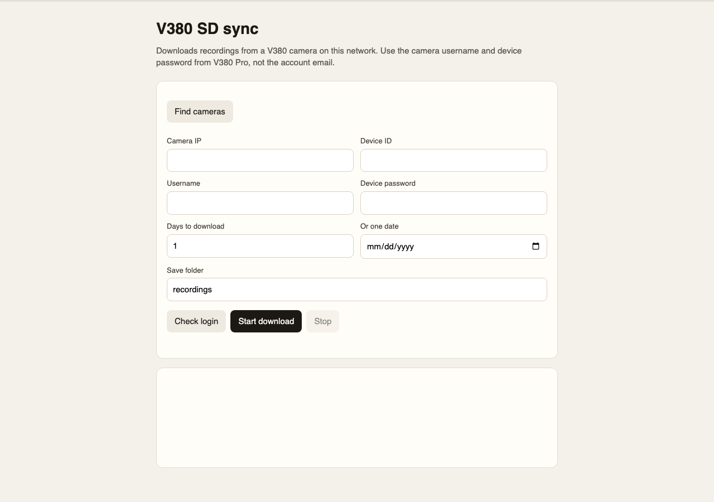
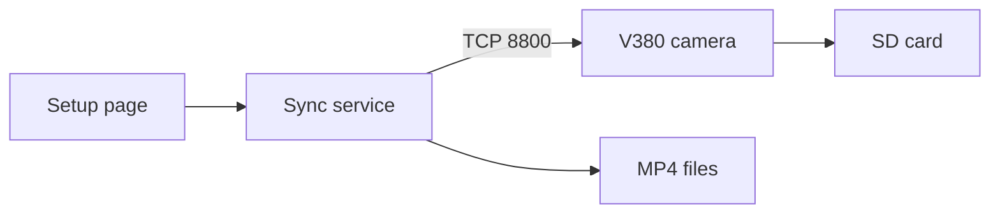

# V380 SD card PC sync

A local program that syncs recordings from a V380 CCTV camera SD card onto a PC and saves them as normal MP4 files.

The camera stays on the same network as the PC. Nothing in this project signs in to a V380 cloud account, and camera passwords are never stored in the repository.



## Install on Windows

Download **V380SdSync-Setup.exe** from [Releases](https://github.com/torrefrancae/v380-sd-card-pc-sync/releases).

The installer does not need administrator rights. It places the app in the user profile, adds a Start menu and desktop shortcut, and opens the setup page. Node.js and ffmpeg are inside the installer, so a Windows PC does not need them installed separately.

Then:

1. Click **Find cameras**.
2. Select the camera. That fills the IP address and device id.
3. Enter the camera username and device password from V380 Pro. This is the device login, not the email and password for the V380 account.
4. Click **Check login**.
5. Click **Start download**.

Finished clips are written to the save folder. Files that are already there are skipped, so a later run only copies what is new. Each clip is about four minutes. A full day takes a few hours because the camera plays each recording out over the network.

The page listens on `http://127.0.0.1:8787` only. The password is sent to the program on that PC and is not forwarded to any other machine.

## How it works



1. A UDP broadcast, `NVDEVSEARCH`, asks cameras on the LAN to answer with their address and device id.
2. Login is a binary request on TCP port 8800. The password is wrapped with AES-128-ECB before it leaves the PC.
3. The service asks for the recording index, one calendar day at a time.
4. Each finished segment is played back, decrypted with the session key from that login, and written as HEVC.
5. ffmpeg copies that stream into an MP4. It does not re-encode.

The playback layout was checked against a camera that reports device version 32. Other firmware can differ.

Recorded frames on that version are 1920 by 3240. That is the camera's three views stacked in one picture, not a scaling bug.

## Develop

Requirements: Node.js 20 and ffmpeg on `PATH`.

```bash
npm install
npm run ui
```

Open `http://127.0.0.1:8787`.

The command line reads a local `.env` copied from `.env.example`:

```bash
npm run sync -- --days 1
npm run sync -- --date 2026-11-17
npm run sync -- --limit 5
```

`npm run build` writes `dist/server.mjs` for the Windows package.

## Windows package

GitHub Actions on `windows-latest` builds `V380SdSync-Setup.exe` when a `v*` tag is pushed. The workflow:

- bundles `src/server.ts` with esbuild
- downloads the Node.js 20 Windows binary and a GPL ffmpeg build
- compiles `installer/V380SdSync.iss` with Inno Setup

ffmpeg is shipped as a separate program. Its license file is copied into the install folder as `FFMPEG-LICENSE.txt`. The rest of this repository is under the MIT license.

## Layout

| Path | Role |
| --- | --- |
| `src/server.ts` | Local page and HTTP API |
| `src/session.ts` | Discovery, login, media key |
| `src/recordings.ts` | SD index, playback, MP4 mux |
| `src/job.ts` | Download loop, skip existing files, stop |
| `public/index.html` | Setup page |
| `installer/` | Inno Setup script and silent launcher |
| `.github/workflows/windows-installer.yml` | Builds the downloadable setup |

## Security

- `.env` is gitignored. Do not commit camera passwords, account passwords, or recording files.
- The setup page binds to loopback.
- A download can be stopped from the page. The current clip finishes or the socket closes, and a half-written MP4 is removed.
