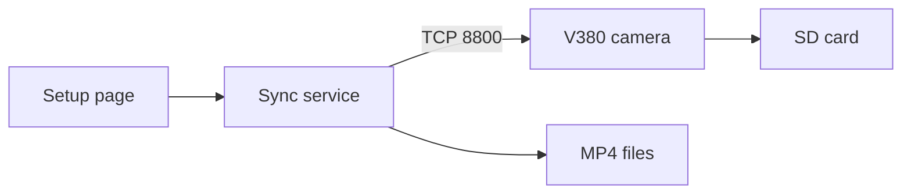

# V380 SD card PC sync

A local program that syncs recordings from a V380 CCTV camera SD card onto a PC and saves them as normal MP4 files.

The camera stays on the same network as the PC. Nothing in this project signs in to a V380 cloud account, and camera passwords are never stored in the repository.


## Install on Windows

Download **V380SdSync-Setup.exe** from the [latest release](https://github.com/torrefrancae/v380-sd-card-pc-sync/releases/latest/download/V380SdSync-Setup.exe). The steps for users, including the browser warning for this unsigned installer, are in [INSTALL.md](INSTALL.md).

The installer does not need administrator rights. It places the app in the user profile, adds a Start menu and desktop shortcut, and opens the setup page. Node.js and ffmpeg are inside the installer. If ffmpeg is missing on a Windows PC, the first open downloads it into the app folder.

Then:

1. Click **Find on network**, or **Scan V380** after signing in to the V380 app on this PC.
2. Select the camera and enter its device username and device password.
3. Click **Save camera**, or click **Start download**. Starting a download saves the camera on this PC.
4. The next time, choose it under **Saved cameras**. It no longer appears under Find on network. Cameras found on the network are shown in a highlighted list with a camera icon. Each saved camera has **Settings**, **Files**, and **Live**. Live hides the file list and shows the camera's current picture. That picture is the camera's live stream, not a saved clip, and it updates as new frames arrive. When the camera sends three views stacked in one picture, Live splits them into three. Vertical stacks them, Horizontal puts them in a row, Focus keeps one large with two small ones on the right, and Pair puts two large ones over a small one centered below. While Focus is selected, click a view to make it the large one. The page address remembers Settings, Files, Live, the layout, the open clip, and Maximize, so a refresh keeps the same view. Maximize fills the browser window with the picture and leaves the browser itself visible. In that enlarged view the layout choices sit at the bottom right. Otherwise they are in a dropdown next to Maximize. The camera stream runs only while Live is maximized and the window is visible. A smaller Live view does not open the camera. If pictures stop arriving, the page opens the stream again. The page also reloads once an hour so a stuck view does not stay on screen.

The device login is the camera username and password set in the V380 Android or iOS app: three dots at the top right of the camera, **Settings**, **Password**, **Change device password**. Enter that password twice there so it is not forgotten, then type the same username and password into this program. It is separate from the V380 account email. Saved cameras stay on this PC. The default download is the last 7 days. A date in **Or one date** uses that day only.

The download stays running after the page is closed. Each check takes the most recent finished clip. When that day has no finished clip left to copy, the next most recent day is used, again starting with its newest clip. A clip that is still being recorded is picked up after it ends. Files already in the save folder are skipped. Pause holds the download, and Play continues it. The program restarts itself at 3:00 and continues a download that is not paused.

After a download starts, the page becomes a file list grouped by day. The newest day is open. Older days stay closed until opened. Each clip shows its date and time, copy progress, and a remark such as New, Older, or Saved. Click a clip to play it in the panel beside the list. While a clip is open, the list keeps only the file name so the picture can use the rest of the page. One clip plays at a time, in this page. A **Show in Explorer** button opens that day's folder on the PC.

**Keep local videos** limits how long those copies stay on the PC. The default is 30 days. An older video is deleted from this PC only when a new one is saved, one in and one out. Deleted copies stay in the list with the name crossed out and a remark such as Deleted, 60 minutes old. They are downloaded again only after the keep limit is raised enough to include them. Change the number of minutes, hours, days, weeks, or months, then **Apply keep**. Clear the number to keep every saved video. The camera SD card is left as it is.

The page listens on `http://127.0.0.1:8787` only. The password is sent to the program on that PC and is not forwarded to any other machine.

## How it works



1. A UDP broadcast, `NVDEVSEARCH`, asks cameras on the LAN to answer with their address and device id.
2. Login is a binary request on TCP port 8800. The password is wrapped with AES-128-ECB before it leaves the PC.
3. The service asks for the recording index, one calendar day at a time.
4. Each finished segment is played back, decrypted with the session key from that login, and written as HEVC.
5. ffmpeg copies that stream into an MP4. It does not re-encode.

The playback layout was checked against a camera that reports device version 32. Other firmware can differ.

Recorded frames on that version are 1920 by 3240. That is the camera's three views stacked in one picture, not a scaling bug. Live uses the same stack and shows each third on its own. The live path sends about 8 pictures a second, keeps each picture whole, and closes a silent camera so the page can open a fresh stream.

## Develop

Requirements: Node.js 20 and ffmpeg on `PATH`.

```bash
npm install
npm run ui
```

Open `http://127.0.0.1:8787`.

The command line reads a local `.env` copied from `.env.example`:

```bash
npm run sync -- --days 1
npm run sync -- --date 2026-11-17
npm run sync -- --limit 5
```

`npm run build` writes `dist/server.mjs` for the Windows package.

## Windows package

GitHub Actions on `windows-latest` builds `V380SdSync-Setup.exe` when a `v*` tag is pushed. The workflow:

- bundles `src/server.ts` with esbuild
- downloads the Node.js 20 Windows binary and a GPL ffmpeg build
- compiles `installer/V380SdSync.iss` with Inno Setup

ffmpeg is shipped as a separate program. Its license file is copied into the install folder as `FFMPEG-LICENSE.txt`. The rest of this repository is under the MIT license.

## Layout

| Path | Role |
| --- | --- |
| `src/server.ts` | Local page and HTTP API |
| `src/session.ts` | Discovery, login, media key |
| `src/recordings.ts` | SD index, playback, MP4 mux |
| `src/job.ts` | Live download loop, newest finished clip first |
| `src/saved-cameras.ts` | Camera logins saved on this PC |
| `src/duty.ts` | Resume a download after the 3:00 restart |
| `src/media.ts` | Saved clips, playback, and folder open |
| `src/keep.ts` | Delete local videos older than the keep limit |
| `public/index.html` | Setup page and file list |
| `public/watch.html` | Clip player |
| `INSTALL.md` | Steps a Windows user follows to install |
| `installer/` | Inno Setup script and silent launcher |
| `.github/workflows/windows-installer.yml` | Builds the downloadable setup |

## Security

- `.env` and `runtime/` are gitignored. Do not commit camera passwords, account passwords, or recording files. A saved camera login stays in `runtime/` on that PC.
- The setup page binds to loopback.
- Pause holds a download. The loading bar goes away, a half-written MP4 is removed, and Play continues from the clips already saved.
